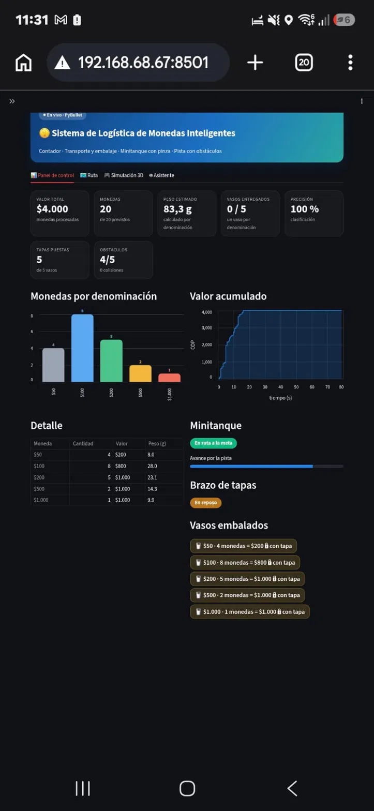

<div align="center">

[](#)

*Universidad Militar Nueva Granada · Microcontroladores*

[](#)

[](#)
[](#)
[](#)
[](#)
[](#)

</div>


## ✨ ¿Qué hace este repositorio?

Este repositorio reúne **solo los avances del diseño mecánico del separador de monedas** del proyecto *Sistema de Logística de Monedas Inteligentes*. El separador clasifica **monedas colombianas de 50, 100, 200, 500 y 1.000 pesos, de la serie nueva y de la antigua**, por su diámetro. En **cada caída del canal** hay un sensor **CNY70** que detecta la moneda; los sensores van conectados a una **ESP32**, que publica el conteo y lo envía al **dashboard en Streamlit** que ya está hecho.

| 🪙 Separador | 🔦 Sensado | 📡 ESP32 | 📊 Dashboard |
| --- | --- | --- | --- |
| Rampa con huecos de ancho creciente: cada moneda sale por el primer hueco en el que cabe | Un **CNY70** en cada caída del canal cuenta cada moneda que pasa | Lee los CNY70 y publica el conteo en **JSON** por Wi-Fi | Muestra valor total, monedas por denominación, peso estimado y más, en computador o celular |

> 💡 El código completo del dashboard y de la simulación está en el repositorio del proyecto final: [Dispensador-de-Monedas-Proyecto-Final](https://github.com/JulianCPT/Dispensador-de-Monedas-Proyecto-Final).

### 📊 Estado del proyecto

| Módulo | Estado |
| --- | --- |
| Medidas de las monedas de la serie nueva | ✅ Listo |
| Medidas de las monedas de la serie antigua | 🚧 Por medir |
| Diseño CAD del separador | 🚧 En desarrollo |
| Planos y fabricación del prototipo | 🚧 En desarrollo |
| Instalación de un CNY70 en cada caída del canal | 🚧 En desarrollo |
| Firmware de la ESP32 y conexión al dashboard | 🚧 En desarrollo |
| Dashboard en Streamlit (KPIs, gráficas, ruta, 3D, asistente) | ✅ Listo |
| Pruebas con monedas nuevas y antiguas | 🚧 Pendiente |


## 📑 Contenido

- [🪙 Monedas y dimensiones](#-monedas-y-dimensiones)
- [🔩 Principio de funcionamiento](#-principio-de-funcionamiento)
- [📸 Capturas y avances](#-capturas-y-avances)
- [📐 Arquitectura general](#-arquitectura-general)
- [📁 Estructura del repositorio](#-estructura-del-repositorio)
- [🔌 Electrónica e integración con la ESP32](#-electr%C3%B3nica-e-integraci%C3%B3n-con-la-esp32)
- [📊 Dashboard (Streamlit)](#-dashboard-streamlit)
- [🚀 Cómo correr el dashboard](#-c%C3%B3mo-correr-el-dashboard)
- [🧠 Conceptos clave](#-conceptos-clave)
- [🧰 Solución de problemas](#-soluci%C3%B3n-de-problemas)
- [🚧 Limitaciones y pendientes](#-limitaciones-y-pendientes)
- [👤 Autor](#-autor)


## 🪙 Monedas y dimensiones

El separador debe manejar las **dos series** de monedas colombianas (50, 100, 200, 500 y 1.000 pesos). Cada moneda sale por el primer hueco de la rampa en el que cabe.

### Serie nueva (2012)

| Moneda | Diámetro | Espesor | Peso | Ancho de hueco (diseño) |
| --- | --- | --- | --- | --- |
| $50 | 17,0 mm | 1,30 mm | 2,00 g | 17,4 mm |
| $100 | 20,3 mm | 1,50 mm | *por medir* ⚠️ | 20,7 mm |
| $200 | 22,4 mm | 1,70 mm | 4,61 g | 22,8 mm |
| $500 | 23,7 mm | 2,05 mm | 7,14 g | 24,1 mm |
| $1.000 | 26,7 mm | 2,70 mm | 9,95 g | canal final (≥ 27,5 mm) |

### Serie antigua

| Moneda | Diámetro | Espesor | Peso | Ancho de hueco (diseño) |
| --- | --- | --- | --- | --- |
| $50 | *por medir* | *por medir* | *por medir* | *por definir* |
| $100 | *por medir* | *por medir* | *por medir* | *por definir* |
| $200 | *por medir* | *por medir* | *por medir* | *por definir* |
| $500 | *por medir* | *por medir* | *por medir* | *por definir* |
| $1.000 | *por medir* | *por medir* | *por medir* | *por definir* |

> ⚠️ El peso de la moneda de $100 es **provisional** (3,5 g en el código del dashboard). Pésala con una balanza y corrígelo.
>
> 💡 En la serie nueva la pareja más delicada es **$200 vs $500**: solo se diferencian 1,3 mm, por eso el hueco se diseña con una holgura de unos 0,4 mm sobre el diámetro y se debe considerar la tolerancia de fabricación.
>
> 💡 Si las dos series se van a mezclar en la misma rampa, hay que verificar con las medidas de la serie antigua que los diámetros no se solapen entre denominaciones.

El **peso** que muestra el dashboard es **estimado**: cantidad de cada denominación × su peso nominal. No hay celda de carga.


## 🔩 Principio de funcionamiento

1. **Ingreso:** las monedas entran por la tolva o canal de alimentación.
2. **Separación:** caen sobre una rampa con huecos de ancho creciente; cada moneda sale por el primer hueco en el que cabe. La de mayor diámetro ($1.000) llega al canal final.
3. **Caída por canal:** cada denominación sigue su propio canal hasta una caída.
4. **Detección:** en **cada caída** hay un **CNY70** que detecta el paso de la moneda.
5. **Procesamiento:** los CNY70 están conectados a la **ESP32**, que cuenta cada pulso por denominación.
6. **Visualización:** la ESP32 publica el conteo en JSON por Wi-Fi y el **dashboard en Streamlit** lo lee y lo muestra en tiempo real.
7. **Salida:** cada denominación termina en su propio depósito o vaso.

```
Moneda → Rampa → Canal → Caída → CNY70 → ESP32 → Dashboard (Streamlit)
```

> 📝 *(Completar con el detalle de tu mecanismo: inclinación de la rampa, material, forma de la tolva, etc.)*


## 📸 Capturas y avances

> Las imágenes están en `docs/imagenes/` con estos nombres (o cambia las rutas).

**Diseño CAD del separador**


**Prototipo y pruebas**


**Dashboard en el celular** (misma red Wi-Fi)



### 📋 Bitácora de avances

| Fecha | Avance | Observaciones |
| --- | --- | --- |
| 2026-__-__ | Medición de las monedas | – |
| 2026-__-__ | Primer diseño en CAD | – |
| 2026-__-__ | Primera impresión o prueba | – |
| 2026-__-__ | Instalación de los CNY70 | – |

### 🎥 Video de funcionamiento

- ▶️ [**Funcionamiento del separador**](docs/videos/Video%20Separador.mp4) *(pendiente)*


## 📐 Arquitectura general

| Etapa | Qué hace |
| --- | --- |
| 🟦 **Separador (mecánico)** | Rampa con huecos que clasifica la moneda por diámetro |
| 🟧 **CNY70 (uno por caída)** | Detecta el paso de cada moneda por su canal |
| 🟥 **ESP32** | Cuenta los pulsos y publica el JSON por Wi-Fi (por ejemplo, `http://<IP-ESP32>/datos`) |
| 🟪 **Dashboard (`app_streamlit.py`)** | Lee el JSON con la fuente **ESP32 (URL)** y lo muestra |
| 🟩 **Navegador** | Computador o celular en la misma red Wi-Fi |

> 💡 **Idea clave:** el dashboard no depende de cómo se produce el dato (simulación o ESP32), solo de que el JSON tenga el formato esperado. Por eso la ESP32 puede reemplazar la simulación sin cambiar la visualización.


## 📁 Estructura del repositorio

```
Separador-de-Monedas-Diseno-Mecanico/
├── cad/                  # Archivos CAD (SolidWorks, Fusion, STEP, etc.)
├── stl/                  # Piezas listas para impresión 3D
├── planos/               # Planos 2D (PDF/DXF)
├── calculos/             # Dimensionamiento de huecos y tolerancias
├── electronica/          # Esquemas y código de la ESP32 (CNY70)
├── docs/
│   ├── imagenes/
│   │   ├── cad_separador.png
│   │   ├── prueba_separador.jpeg
│   │   └── dashboard.png
│   └── videos/
│       └── Video Separador.mp4
└── README.md
```


## 🔌 Electrónica e integración con la ESP32

> 🚧 **En desarrollo.** El firmware todavía no está en el repositorio.

| Parte | Hardware |
| --- | --- |
| Conteo por canal | Un **CNY70** en cada caída del canal, conectado a pines **ADC1** de la ESP32 (los ADC2 no funcionan bien con el Wi-Fi activo) |
| Comunicación | Wi-Fi (HTTP con JSON) hacia el dashboard |

**Formato mínimo del JSON que publica la ESP32** (cantidad contada por cada denominación):

```json
{
  "cuentas": { "50": 4, "100": 8, "200": 5, "500": 2, "1000": 1 }
}
```

El dashboard usa valores por defecto para el resto de campos, así que con `cuentas` ya muestra el conteo, el valor total y el peso estimado.


## 📊 Dashboard (Streamlit)

El dashboard se ve bien en computador y en celular, y se actualiza solo cada 1 a 5 segundos.

| Pestaña | Contenido |
| --- | --- |
| 📊 Panel de control | Valor total, cantidad de monedas, peso estimado, precisión, gráfica por denominación, valor acumulado y detalle |
| 🗺️ Ruta | Seguimiento del minitanque en la pista con obstáculos |
| 🎮 Simulación 3D | Simulación 3D interactiva |
| 🤖 Asistente | Preguntas sobre el estado del sistema, con respuesta hablada |

**Fuentes de datos** (barra lateral):

| Fuente | Qué hace |
| --- | --- |
| **Auto** | Usa `estado.json` si la simulación lo está actualizando; si no, modo demo |
| **Archivo** | Lee `estado.json` (ruta configurable) |
| **ESP32 (URL)** | Lee el JSON que publica la ESP32, por ejemplo `http://192.168.1.50/datos` |
| **Demo** | Datos de ejemplo, sin hardware |

La barra lateral también permite **cambiar el peso aproximado de cada moneda**.


## 🚀 Cómo correr el dashboard

1. **Instala** las dependencias:

```
pip install streamlit pandas altair
```

2. **Lanza el dashboard** (desde la carpeta donde está `app_streamlit.py`):

```
streamlit run app_streamlit.py
```

   Se abre en el navegador (normalmente `http://localhost:8501`). **No** lo ejecutes con `python app_streamlit.py`.

3. **Elige la fuente** en la barra lateral: **ESP32 (URL)** y escribe la dirección de tu ESP32.

4. **Para verlo en el celular** (misma red Wi-Fi):

```
streamlit run app_streamlit.py --server.address 0.0.0.0
```

   Y en el celular abre `http://IP-DEL-COMPUTADOR:8501`.

> 💡 Si la ESP32 no está disponible, usa la fuente **Demo** para probar el dashboard sin hardware.


## 🧠 Conceptos clave

**📏 Separación por diámetro**

Una rampa con huecos de ancho creciente deja caer cada moneda por el primero en el que cabe. Funciona porque el diámetro crece con el valor (en la serie nueva: 17 < 20,3 < 22,4 < 23,7 < 26,7 mm). Lo crítico es la holgura de cada hueco frente a la tolerancia de las monedas.

**🔦 Sensor óptico (CNY70)**

Un LED infrarrojo y un fototransistor en un solo encapsulado: al pasar una moneda cambia la luz reflejada y la ESP32 lo lee como un pulso por moneda.

**🔌 ADC1 vs ADC2 en la ESP32**

Con el Wi-Fi activo, los canales ADC2 dejan de funcionar bien, por eso las entradas de los sensores deben ir en pines **ADC1** (GPIO 32–39).

**📡 El JSON como contrato**

El dashboard solo necesita que el JSON tenga el formato esperado, sin importar si lo produce una simulación o la ESP32.

**⏱️ Fragmentos de Streamlit (`st.fragment`)**

Permiten que una parte de la página se actualice sola cada cierto tiempo sin volver a ejecutar todo el script.


## 🧰 Solución de problemas

| Problema | Posible solución |
| --- | --- |
| `ModuleNotFoundError` (`altair`, `streamlit`, `pandas`) | Ejecuta `pip install streamlit pandas altair` |
| Sigue sin encontrar el módulo | Usa el mismo Python para ambos: `python -m pip install ...` y `python -m streamlit run app_streamlit.py` |
| El dashboard dice "Modo demo" | Elige la fuente **ESP32 (URL)** o **Archivo** en la barra lateral |
| "No se pudo leer la fuente" con la ESP32 | Revisa la IP y que la ESP32 y el computador estén en la misma red Wi-Fi |
| El celular no abre el dashboard | Misma red Wi-Fi, lanzar con `--server.address 0.0.0.0` y permitir el puerto **8501** en el firewall |
| El conteo se pierde o falla con Wi-Fi activo | Verifica que los CNY70 estén en pines **ADC1** |
| Una moneda cae por el hueco equivocado | Revisa la holgura de ese hueco frente al diámetro real medido, sobre todo en $200 vs $500 |


## 🚧 Limitaciones y pendientes

- Las medidas de la **serie antigua** están por tomar; el diseño de los huecos de esa serie depende de ellas.
- El peso de la moneda de **$100** es provisional.
- El **peso** del dashboard es estimado (no hay celda de carga).
- El firmware de la ESP32 y la instalación final de los CNY70 siguen en desarrollo.


## 👤 Autor

**Julian Camilo Perez Torres** · Universidad Militar Nueva Granada · Microcontroladores

[](#)
